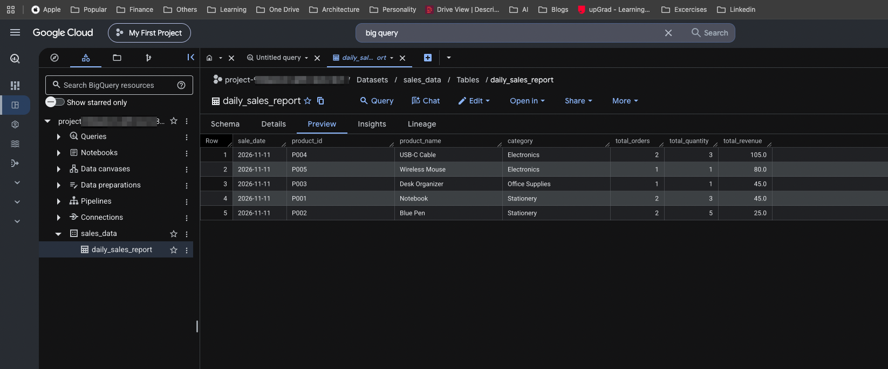
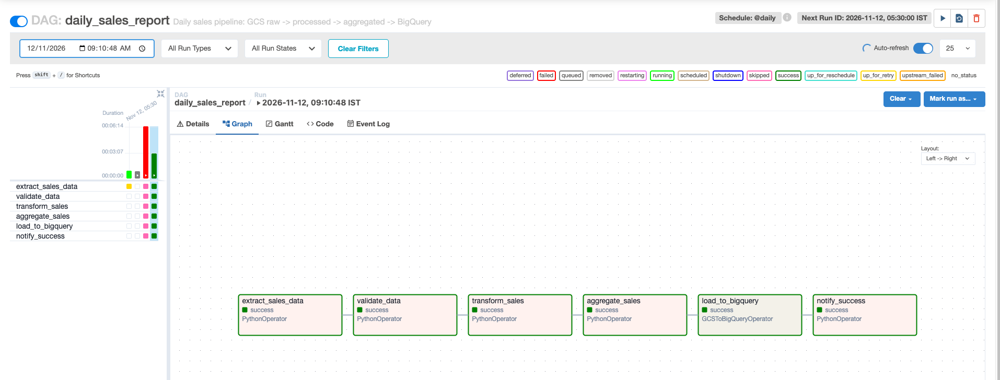

# Daily Sales Report Pipeline

This project contains an Apache Airflow DAG for Google Cloud Composer. The
DAG checks for a daily sales CSV in Cloud Storage and loads an aggregated CSV
into BigQuery.

## Project files

```text
.
├── daily_sales_report.py
├── requirements.txt
├── terraform
└── README.md
```

## Prerequisites

- A Google Cloud project with Cloud Composer, Cloud Storage, and BigQuery
  enabled
- A Cloud Composer environment running a compatible version of Apache Airflow
- A Cloud Storage bucket
- A BigQuery dataset named `sales_data`
- A Composer service account that can read the bucket and write to BigQuery

To create the above cloud infrastructure with Terraform, follow
[Terraform setup](./terraform/README.md). It provisions Composer, the sales
bucket, dataset, and table, and sets the environment variables below in
Composer. For that deployment, you do not need to upload `.env` or install
packages manually.


## Configuration


The DAG reads these required values from the Composer environment:

```text
SALES_PROJECT_ID=your-gcp-project-id
SALES_GCS_BUCKET=your-gcs-bucket-name
```

Terraform configures these values through `Environment Variables`.
If you create the environment manually, configure the same values in the
Composer environment's environment variables. `SALES_GCS_BUCKET` must contain
only the bucket name, without the `gs://` prefix.

The DAG expects files using these Cloud Storage paths, where
`YYYY-MM-DD` is the Airflow execution date:

```text
gs://YOUR_BUCKET/raw/sales_YYYY-MM-DD.csv
```

The raw CSV must contain this header:

```text
sale_date,product_id,product_name,category,order_id,quantity,unit_price
```

The DAG writes a processed CSV with this header:

```text
sale_date,product_id,product_name,category,order_id,quantity,unit_price,line_revenue
```

It then writes an aggregated CSV with this header:

```text
sale_date,product_id,product_name,category,total_orders,total_quantity,total_revenue
```

## Create a local virtual environment

From the project directory, create and activate a virtual environment on
macOS or Linux:

```bash
python3 -m venv .venv
source .venv/bin/activate
```

When finished, exit the virtual environment with:

```bash
deactivate
```

## Install dependencies

Cloud Composer provides Apache Airflow and the Google provider used by this DAG. This project has no additional Python package requirements, so no PyPI package installation is needed.

If you later add third-party imports, install only those packages through
**Composer > Environment configuration > PyPI packages**.

## Deploy DAG

THe DAG file is already uploaded by the terraform. You will not need the below commands, unless you want to upload it manually.

Upload the DAG file to the Composer environment's `dags/` directory:

```bash
gcloud composer environments storage dags import \
  --environment YOUR_COMPOSER_ENVIRONMENT \
  --location YOUR_COMPOSER_REGION \
  --source "daily_sales_report.py"
```

For a test run with the included sample, upload the raw file to the path
matching the run's logical date:

```bash
gcloud storage cp data/sales_2026-11-11_raw.csv \
  gs://YOUR_BUCKET/raw/sales/sales_2026-11-11.csv
```

## Run the DAG

1. Open the Airflow UI from the Composer environment.
2. Find the `daily_sales_report` DAG and enable it.
3. Trigger a manual run for testing, or wait for its daily schedule.
4. Review the task logs and verify the rows in
   `sales_data.daily_sales_report`.

The DAG runs daily, does not catch up on missed dates, and permits only one
active run at a time.

Sample raw, processed, and aggregated files are available in
[`data/`](./data/).

## Pipeline behavior

For each Airflow execution date, the DAG:

1. Verifies that `raw/sales/sales_YYYY-MM-DD.csv` exists.
2. Validates the raw CSV and calculates `line_revenue` as
   `quantity * unit_price`.
3. Uploads the validated rows to
   `processed/sales/sales_YYYY-MM-DD_processed.csv`.
4. Aggregates order count, quantity, and revenue by product.
5. Uploads the result to
   `processed/sales/sales_YYYY-MM-DD_aggregated.csv`.
6. Loads the aggregated CSV into BigQuery.

The Composer service account needs permission to read and write objects in the
sales bucket. The Terraform configuration grants `roles/storage.objectAdmin`
for this bucket.

## Local syntax check

If Airflow and the listed dependencies are installed locally, check the DAG
syntax with:

```bash
python -m py_compile daily_sales_report.py
```

This checks Python syntax only; it does not connect to Google Cloud or execute
the DAG.


## Output

### BigQuery Table


### Composer
